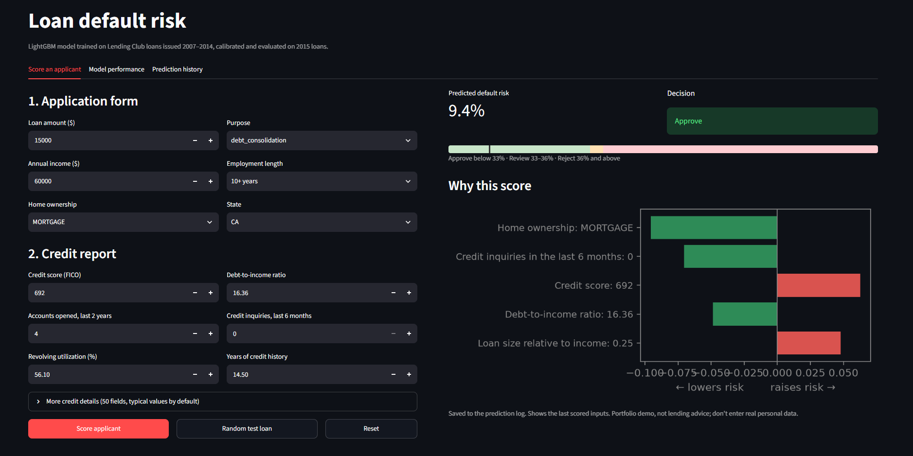
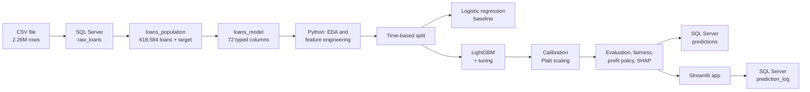
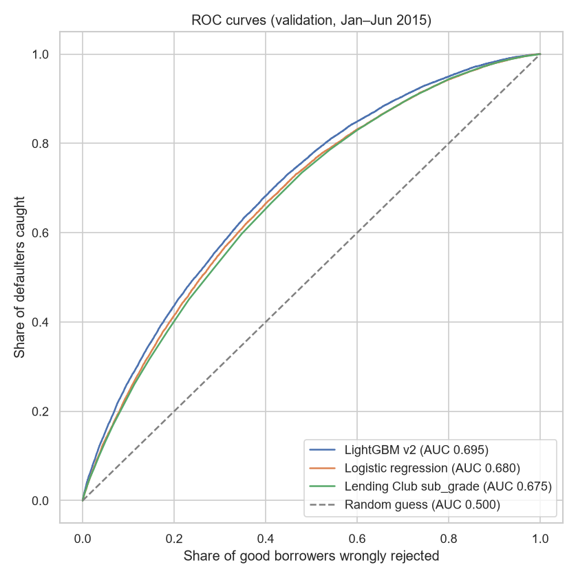
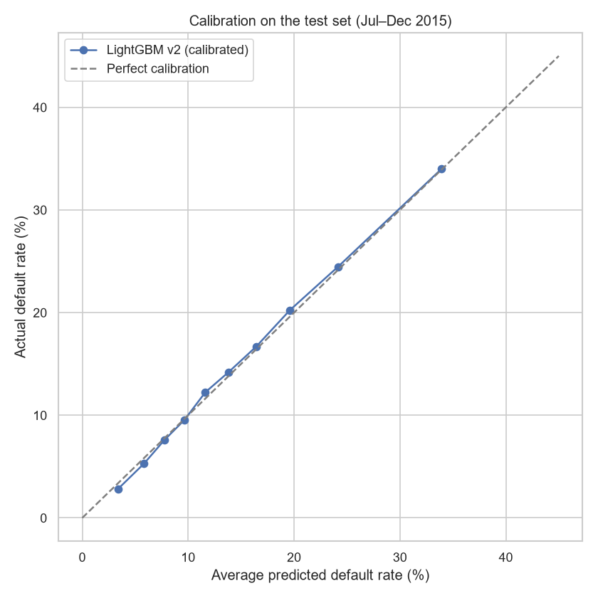
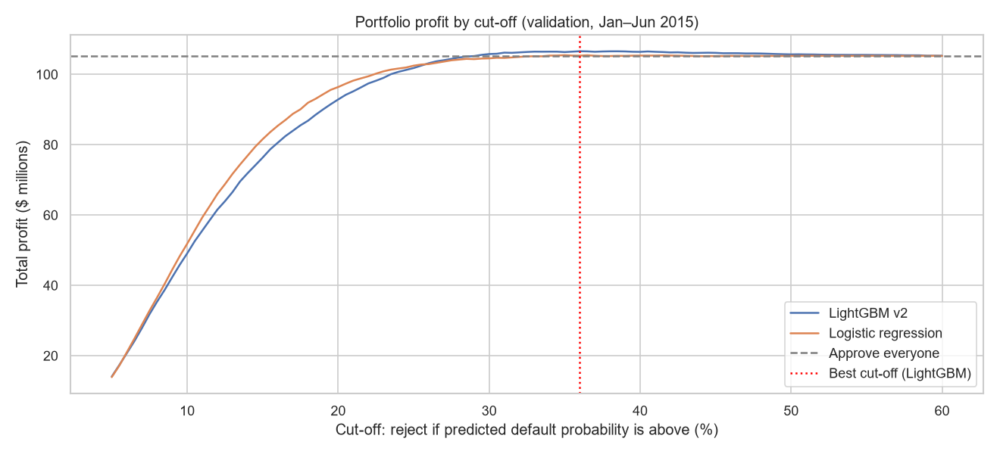
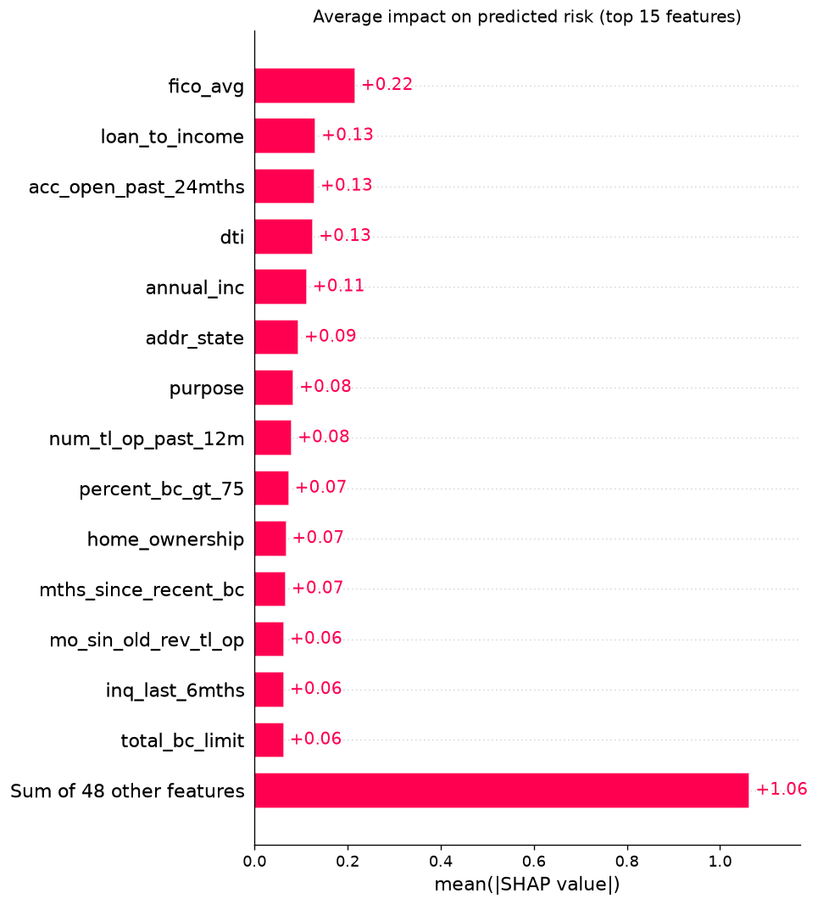
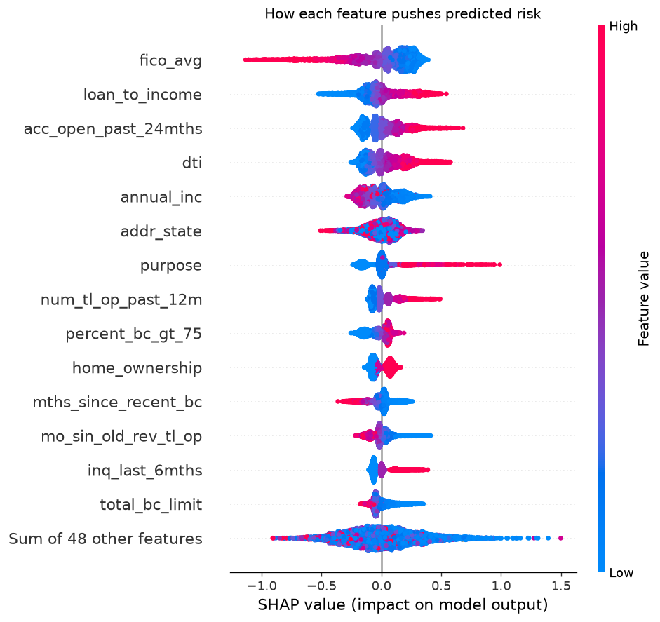

# Loan Default Prediction: Lending Club

An end-to-end credit risk project: from 2.26 million raw loan records to a calibrated, explainable model, a profit-based approval policy, and an interactive Streamlit app that scores applicants, explains every decision, and logs predictions to SQL Server.

**Headline result:** on loans issued in July–December 2015, which the model never saw during training, tuning, or calibration, a LightGBM model using only application-time information reached a **test AUC of 0.703** (Gini 0.405, KS 0.294), outperforming both a logistic regression baseline (0.687) and Lending Club's own sub-grade (0.681). A 36% approval cut-off would have earned **$2.55 million more** than approving every loan in that period.


**Live demo:** https://your-app-name.streamlit.app (may take a minute to wake up if nobody has used it recently)




---

## Contents

- [Problem definition](#problem-definition)
- [Data](#data)
- [Approach](#approach)
- [Key findings from the data](#key-findings-from-the-data)
- [Results](#results)
- [Approval policy and business value](#approval-policy-and-business-value)
- [Explainability](#explainability)
- [Fairness checks](#fairness-checks)
- [The app](#the-app)
- [Project structure](#project-structure)
- [How to reproduce](#how-to-reproduce)
- [Limitations](#limitations)
- [Future work](#future-work)
- [Tech stack](#tech-stack)

---

## Problem definition

> Predict the probability that a 36-month Lending Club loan will be charged off, using only information available when the borrower applied, so the lender can approve, reject, or send applications to manual review.

| Element | Choice |
|---|---|
| Unit | One loan application |
| Prediction moment | The day the application is submitted |
| Target | `1` = Charged Off or Default, `0` = Fully Paid |
| Population | 36-month loans issued 2007–2015 with a final outcome |
| Excluded | Unfinished loans (Current, Late, Grace Period), loans issued under Lending Club's older credit policy, 60-month loans |
| Primary metric | ROC-AUC (also Gini and KS, the banking conventions) |
| Secondary | Calibration (Brier score, calibration curves), portfolio profit |

**Why "charged off" rather than "90+ days past due within 12 months"?** The public Lending Club data contains each loan's final status rather than a month-by-month payment history, so the outcome over the full term is the most reliable target. It directly answers the lender's question: *"If I approve this loan, will I lose money on it?"*

**Why only loans issued through 2015?** A 36-month loan issued in 2016 or later may not have finished by the end of the data. Including those would bias the target toward early defaults. Through 2015, only 147 loans were still unfinished.

---

## Data

- **Source:** [Lending Club loan data on Kaggle](https://www.kaggle.com/datasets/wordsforthewise/lending-club), file `accepted_2007_to_2018Q4.csv.gz`
- **Raw size:** 2,260,701 rows × 151 columns (including 33 summary rows at the end of the file, which were excluded)
- **Column definitions:** [Lending Club data dictionary](https://figshare.com/articles/dataset/Lending_club_dataset_description/20016077)
- **Project population:** 618,584 loans, 85,955 charged off (**13.9% default rate**)

The data is not included in this repository because of its size. See [How to reproduce](#how-to-reproduce).

---

## Approach



### 1. Data preparation in SQL Server
- Loaded the raw file in chunks into a staging table (`raw_loans`) with every column as text, then selected the population and built the target in T-SQL (`loans_population`).
- Found and handled real-world issues: a hidden leading space in `term` (`' 36 months'`), dates stored as `Mon-YYYY` text, and 33 summary rows mixed into the data.
- **Leakage audit:** classified all 151 columns with one question: *would a lender know this on application day?* Removed payment history, recoveries, hardship and settlement data, and the borrower's credit score pulled *after* the loan started. Lending Club's own `grade`, `sub_grade`, and `int_rate` were excluded from the features (they are the output of Lending Club's model) but kept as a benchmark. `zip_code` was excluded as a potential proxy for protected characteristics.
- Created a typed modeling table (`loans_model`) with 63 candidate features, verified to have zero failed type conversions.

### 2. Feature engineering (`src/features.py`)
One function applies the same fixed rules to training data, test data, and new applicants in the app:
- Placeholder values set to missing (income of 0, DTI of 999, credit limits of 9,999,999)
- New features: `fico_avg`, `loan_to_income`, `credit_history_months`, `emp_length_years` plus a missing flag, `total_bal_to_limit`
- Rare categories merged; four near-duplicate features removed (correlation ≥ 0.97)
- **Result: 62 features** (57 numeric, 4 categorical, 1 binary)

### 3. Time-based split (`src/split.py`)

| Set | Issue dates | Loans | Default rate |
|---|---|---|---|
| Train | 2007 – 2014 | 335,558 | 13.06% |
| Validation | Jan – Jun 2015 | 120,790 | 15.12% |
| Test | Jul – Dec 2015 | 162,236 | 14.71% |

Splitting by time mirrors real use: train on the past, predict the future. The test set was used once, at the very end.

### 4. Models (`src/models.py`)
- **Baseline:** logistic regression in a scikit-learn pipeline (quantile transform, median imputation with missing-value indicators, one-hot encoding).
- **Main model:** LightGBM with early stopping. Seven tuning experiments compared tree complexity, regularization, and the handling of the 47-level state feature. The chosen configuration (15 leaves, at least 500 loans per leaf, cautious categorical settings, 813 trees) had the highest validation AUC within 0.001 of the best and the smallest train/validation gap.
- **Calibration:** the model learned from 2007–2014 (13.1% default) and under-predicted risk in 2015 (15.1%). Platt scaling fitted on the validation set corrected the probability level without changing the ranking.

---

## Key findings from the data

- **Strongest signals:** FICO score (default falls from ~19% in the lowest decile to ~5.5% in the highest), income (~20% → ~9.5%), and debt-to-income (~10.5% → ~19.7%).
- **Loan amount alone is weak and misleading:** its relationship with default is non-monotonic, because larger loans go to borrowers who can afford them. Dividing by income (`loan_to_income`) turned it into a strong, steady signal (11% → 18.8%).
- **Missing values carry information:** applicants who didn't provide employment length defaulted at 20.5%, versus ~14% for any stated length. Nulls in `mths_since_*` columns mean "never happened," not "unknown."
- **Verified income defaults more** (16.2% vs 11.6% unverified), likely because Lending Club chose to verify riskier applicants.
- **Utilization above 100%** is a strong risk signal (~20% default), so these extreme values were kept rather than removed.
- **Drift:** the default rate rose from ~10% (2010) to ~15% (2015), so the evaluation periods are riskier than most of the training data.

---

## Results

### Test set (Jul–Dec 2015, 162,236 loans)

| Model | AUC | Gini | KS |
|---|---|---|---|
| **LightGBM (calibrated)** | **0.703** | **0.405** | **0.294** |
| Logistic regression | 0.687 | 0.374 | 0.271 |
| Lending Club sub-grade | 0.681 | 0.363 | 0.267 |

- **The lead over Lending Club is real:** +0.021 AUC, with a 95% bootstrap interval of 0.018 to 0.024. LightGBM ranked better in all 200 bootstrap samples.
- **No sign of overfitting to validation:** test AUC (0.703) was slightly higher than validation AUC (0.695).
- **Calibration holds on unseen data:** average predicted risk 14.6% vs actual 14.7%. Brier score 0.117, about 7% better than predicting the average rate for everyone.
- **Hidden risk inside "safe" grades:** among grade B loans, the 247 the model would reject defaulted at 33.2%, roughly three times the grade's typical rate.

<p float="left">
  
  
</p>

---

## Approval policy and business value

Each loan's realized profit is `total_pymnt − funded_amnt`. A repaid loan earned about **+$1,840** on average; a defaulted loan lost about **−$4,567**, so one default wipes out the profit of roughly 2.5 good loans.

The cut-off was chosen on **validation** and reported on **test**:

| Policy (test set) | Approved | Default rate of approved | Profit | Gain vs approve all |
|---|---|---|---|---|
| Approve everyone | 100% | 14.71% | $132.20M | — |
| Logistic regression policy | 98.5% | 14.32% | $132.81M | +$0.61M |
| **LightGBM policy (reject at 36%+)** | **97.2%** | **13.95%** | **$134.75M** | **+$2.55M** |

Adding a 3-point manual review band below the cut-off:

| Decision | Share of applicants | Actual default rate |
|---|---|---|
| Approve | 95.5% | 13.6% |
| Review | 1.7% | 33.3% |
| Reject | 2.8% | 40.8% |

**Why the cut-off is high and the gain is modest:** every loan in this data was already approved and priced by Lending Club, with higher interest rates for riskier borrowers. The model acts as a second filter on an already-screened portfolio. A lender making its own decisions from scratch, especially for risk-based pricing, would get more value from a better model.



---

## Explainability

SHAP values explain both the model as a whole and every individual decision.

**Most influential features overall:** credit score, loan size relative to income, accounts opened in the last two years, debt-to-income, and income. All push risk in the expected direction.

**Most common main reason for rejection** (test set): accounts opened in the last two years (27%), loan size relative to income (18%), credit score (16%), and debt-to-income (12%). Rapid account opening, a sign of urgent credit need, tips more applicants into rejection than a low credit score does.

<p float="left">
  
  
</p>

---

## Fairness checks

The data contains no race, gender, or age, so a full fairness audit isn't possible. Checks across available groups (validation set):

- **Calibration is fair across income, home ownership, verification status, and most loan purposes:** average predicted risk is within about 1 percentage point of the actual rate for each group.
- **The model ranks low-income borrowers less accurately:** AUC 0.652 for the lowest income quartile versus 0.715 for the highest. Decisions are less reliable for this group.
- **Some states are mis-scored by 2–3 points** (for example, Tennessee over-predicted, Louisiana under-predicted), because state-level patterns shifted over time. State is kept as a feature because it adds a small amount of predictive power, but it should be monitored.

---

## The app

A Streamlit app with three tabs:

1. **Score an applicant:** an application form and the main credit report fields (the other 50 features default to typical training values and can be edited). Shows the predicted risk, the decision with its position on an approve / review / reject bar, the top five reasons from SHAP, and the main reasons against approval. A **random test loan** button fills all 62 features with a real 2015 borrower and shows what actually happened to them.
2. **Model performance:** the test results, the comparison with Lending Club, the profit policy, and the evaluation charts.
3. **Prediction history:** reads the `prediction_log` table from SQL Server, summarizes decisions, and compares the app's predictions on unedited test loans with their actual outcomes.

Every prediction is logged to SQL Server with its inputs, probability, decision, and top three reasons. Test loans edited in the form are logged separately (`test_loan_edited`) without their original outcome, so accuracy checks only use genuine borrower data. If no database is available, the app runs without logging.

*This is a portfolio demonstration, not a lending tool.*

---

## Project structure

```
loan-default-project/
├── app.py                      Streamlit app
├── requirements.txt
├── sql/
│   ├── 01_create_raw_loans.sql       Staging table (generated by notebook 02)
│   ├── 02_explore_raw.sql            Status, term, and date exploration
│   ├── 03_create_population.sql      Population and target
│   ├── 04_column_audit.sql           Column summary for the leakage audit
│   ├── 05_create_model_table.sql     Typed modeling table
│   ├── 06_create_predictions.sql     Test predictions with SHAP reasons
│   ├── 07_analyze_predictions.sql    Example analysis queries
│   └── 08_create_prediction_log.sql  App prediction log
├── src/
│   ├── db.py              SQL Server connection
│   ├── features.py        Feature engineering
│   ├── split.py           Time-based split
│   ├── models.py          Pipelines and calibration
│   ├── policy.py          Approve / review / reject rule
│   ├── explain.py         SHAP explanations
│   └── app_support.py     App helpers
├── notebooks/
│   ├── 01_setup_check.ipynb
│   ├── 02_load_data.ipynb
│   ├── 03_eda.ipynb
│   ├── 04_features.ipynb
│   ├── 05_split.ipynb
│   ├── 06_baseline.ipynb
│   ├── 07_lightgbm.ipynb
│   ├── 08_evaluation.ipynb
│   ├── 09_policy.ipynb
│   ├── 10_shap.ipynb
│   ├── 11_save_results.ipynb
│   └── 12_app_assets.ipynb
├── results/
│   ├── metrics.json
│   ├── policy.json
│   ├── policy_test_results.csv
│   ├── lightgbm_tuning.csv
│   └── figures/
├── data/        (not in Git) raw and processed data
└── models/      (not in Git) trained models and app assets
```

---

## How to reproduce

**Requirements:** Python 3.11 or later (developed with 3.13), SQL Server (any edition, including Express or Developer) with ODBC Driver 17 or 18, and about 5 GB of free disk space.

```bash
git clone https://github.com/ahmad-abudiak/loan-default-project.git
cd loan-default-project
python -m venv .venv
.venv\Scripts\activate          # Windows
# source .venv/bin/activate     # macOS / Linux
pip install -r requirements.txt
```

1. Download `accepted_2007_to_2018Q4.csv.gz` from [Kaggle](https://www.kaggle.com/datasets/wordsforthewise/lending-club) into `data/raw/` (keep it compressed).
2. In SQL Server, run `CREATE DATABASE LoanDefault;`. If your server isn't `localhost` or uses a different driver, edit `src/db.py`.
3. Run the notebooks and SQL scripts in this order:

| Order | File | What it does |
|---|---|---|
| 1 | `notebooks/01_setup_check.ipynb` | Checks libraries and the database connection |
| 2 | `notebooks/02_load_data.ipynb` | Profiles the file, creates and fills `raw_loans` |
| 3 | `sql/02` to `sql/05` | Exploration, population, column audit, modeling table |
| 4 | `notebooks/03` to `notebooks/10` | EDA, features, split, models, evaluation, policy, SHAP |
| 5 | `sql/06_create_predictions.sql` | Creates the predictions table |
| 6 | `notebooks/11_save_results.ipynb` | Fills the predictions table |
| 7 | `sql/08_create_prediction_log.sql` | Creates the app's log table |
| 8 | `notebooks/12_app_assets.ipynb` | Typical applicant and demo loans for the app |

4. Start the app:

```bash
streamlit run app.py
```

---

## Limitations

- **Selection bias:** only loans Lending Club approved are observed. How rejected applicants would have performed is unknown.
- **Simplified profit:** no time value of money, funding costs, or operating costs. Dollar figures are for comparing policies, not exact profit.
- **No protected attributes** in the data, so fairness could only be checked on proxies such as income and state.
- **Calibration at the low end:** Platt scaling slightly over-predicts risk for the safest borrowers (about 3.4% predicted vs 2.8% actual in the lowest decile).
- **Rare categories** were identified using loan counts across the full dataset rather than training data only. The risk is minimal because only counts, not outcomes, were used.
- **Range of the training data:** the largest loan in the data is $35,000; predictions for larger amounts are extrapolations.
- **Demo inputs:** manual entries in the app use typical values for 50 of the 62 features, so they approximate real credit reports.

---

## Future work

- Redo the data preparation in pandas and confirm identical results
- Predict **90+ days past due within 12 months** (the banking standard), approximately with Lending Club data, or exactly with the Freddie Mac loan-level dataset
- Use `emp_title` (free-text job title) as a feature
- Compare test results with and without `addr_state`, and monitor state-level calibration
- Risk-based pricing instead of approve / reject decisions
- Deploy the app online, with a FastAPI service and Docker

---

## Tech stack

- **Data:** SQL Server (T-SQL), pandas, NumPy, PyArrow
- **Modeling:** scikit-learn, LightGBM
- **Explainability:** SHAP
- **Visualization:** Matplotlib, seaborn
- **App:** Streamlit
- **Tools:** VS Code, Jupyter, Git
